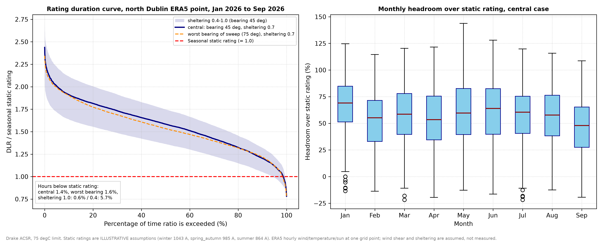
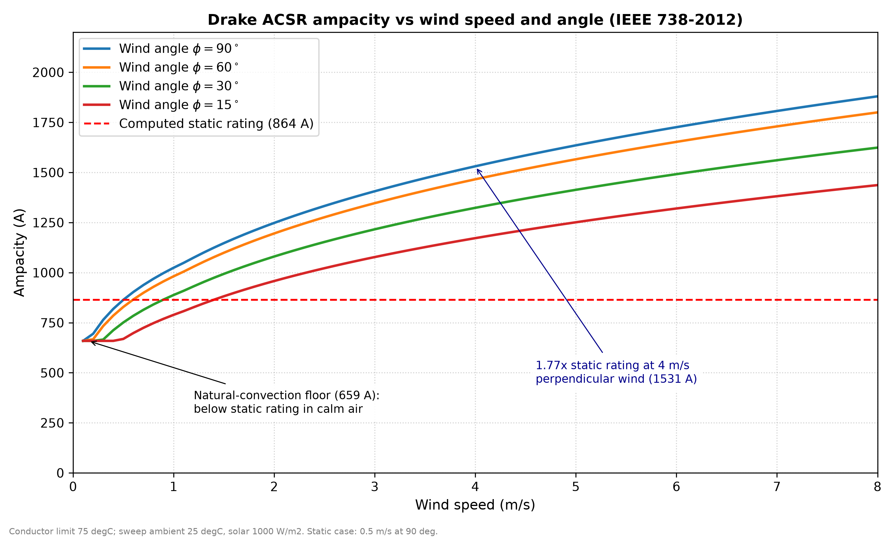
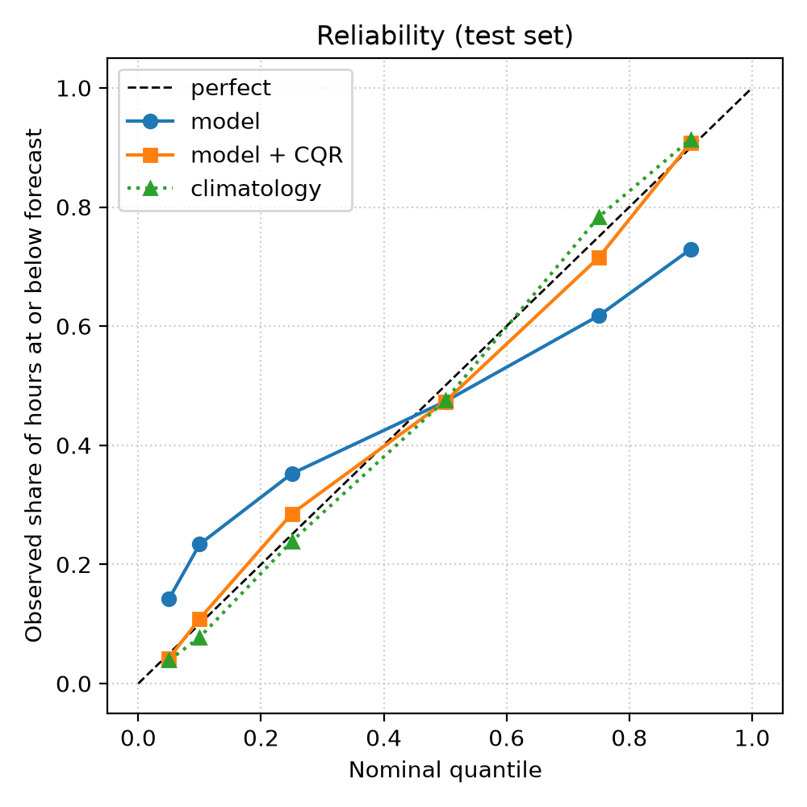

# Probabilistic Dynamic Line Rating for Irish Wind Corridors

A **Python toolkit for probabilistic dynamic line rating (DLR) of Irish overhead lines**, built to ask how much extra current a line can carry when its rating follows the weather, end-to-end from ERA5 reanalysis, an IEEE 738 conductor heat balance and sun-angle-resolved solar gain to a conformally calibrated day-ahead ampacity forecast.

It combines four pieces of work:

- **IEEE 738 heat-balance engine** -: a pure scalar-Python steady-state conductor model, portable enough to run on a microcontroller.
- **Sun-angle-resolved solar gain** -: direct beam resolved against line bearing, plus CIGRE TB 601 / TB 207 diffuse and ground-reflected terms.
- **Headroom bands** -: results reported as ranges over line bearing, sheltering factor and diffuse-sky model, not single numbers.
- **Conformal day-ahead quantile forecast** -: LightGBM quantile models of ampacity (amps), calibrated by split-conformal shifts and scored against climatology.

> **Status: provisional.** Results use one ERA5 grid point (north Dublin), nine months of data (Jan-Sep 2026), an illustrative Drake ACSR conductor and illustrative static ratings. They show the method working, not a finding about any real ESB Networks or EirGrid line. See [Limitations](#limitations).
>
> This is the software half of a two-part project. The heated-conductor test rig (the hardware half) is planned and **not built yet**.

---

## Table of Contents

- [About](#about)
- [Results](#results)
- [Project Structure](#project-structure)
- [How It Works](#how-it-works)
- [Mathematical Formulation](#mathematical-formulation)
- [Getting Started](#getting-started)
- [Running the Project](#running-the-project)
- [Inputs: What Each Module Expects](#inputs-what-each-module-expects)
- [Outputs](#outputs)
- [Validation](#validation)
- [Limitations](#limitations)
- [Tech Stack](#tech-stack)
- [Data](#data)
- [Roadmap](#roadmap)
- [License](#license)
- [Development Notes](#development-notes)

---

## About

Overhead lines are normally rated with a fixed seasonal number. This project asks three questions:

1. How much extra current could a line carry when its rating follows the weather?
2. How often would it carry *less* than the static rating?
3. How confident can a day-ahead rating be?

---

## Results

Headroom is the dynamic rating relative to the seasonal static rating of the same hour. Illustrative static ratings: winter 1043 A, spring/autumn 985 A, summer 864 A (Drake ACSR 26/7, 75 °C limit). P5 and P1 are the headroom exceeded in 95 % and 99 % of hours: the numbers an operator can rely on.

### Central case

Line bearing 45°, sheltering factor 0.7, CIGRE TB 601 diffuse model. This is an assumption, not a result.

| Season | Median headroom | P5 | P1 | Hours below static |
|---|---|---|---|---|
| Winter | +61.7 % | +14.3 % | -4.7 % | 1.5 % |
| Spring/autumn | +53.8 % | +9.9 % | -3.5 % | 1.6 % |
| Summer | +60.5 % | +13.1 % | -1.1 % | 1.2 % |
| All hours (6,552) | +58.4 % | +11.8 % | -3.1 % | 1.4 % (89 h, 61 events, longest 6 h) |

### Range over the unknown assumptions

Worst line bearing, sheltering factor 0.4-1.0, two diffuse-sky models.

| Metric | Lowest | Highest |
|---|---|---|
| Median headroom | +31.8 % | +74.8 % |
| P5 headroom | -1.7 % | +22.2 % |
| P1 headroom | -14.1 % | +5.2 % |
| Hours below static rating | 41 (0.6 %) | 387 (5.9 %) |

### Rating duration curve and monthly headroom



*Left: DLR divided by the seasonal static rating, sorted over the period. The shaded band is the range over sheltering factors 0.4-1.0; the dashed line is the worst line bearing of the sweep (75°). The dynamic rating is below static in 1.4 % of hours in the central case, 1.6 % at the worst bearing, and between 0.6 % and 5.7 % across the sheltering range. Right: monthly headroom, central case; monthly medians run from about +48 % (September) to +69 % (January).*

What drives the range:

- **Sheltering factor dominates.** It moves P5 headroom by about 24 points. The diffuse-sky model moves it by about 0.2.
- **Line bearing matters for the tail.** Lines running roughly east-west (75-90°) are the worst case, with about 108 derated hours versus 73-78 for lines at 120-150°. They run parallel to the prevailing south-westerlies and westerlies, which then cool them least.
- **Derating is not a winter problem.** Hours below static occur in every month, including summer calm, warm spells.

### Ampacity sensitivity to wind speed and angle



*Drake ACSR ampacity against wind speed for four wind angles (ambient 25 °C, fixed 1000 W/m² sun). The static rating is 864 A. In calm air natural convection sets a floor of 659 A, below the static rating; a 4 m/s perpendicular wind gives 1531 A, 1.77 times static. Wind nearly parallel to the line (15°) cools far less than a perpendicular wind, which is why bearing matters.*

### Day-ahead forecast reliability



*Observed share of test hours at or below each forecast quantile, against the nominal quantile (values read from the plot).*

LightGBM quantile models forecast the rating in amps 12-35 hours ahead, issued at 12:00 UTC the day before.

- **Raw model: overconfident.** Its nominal 5 % quantile is breached about 14-15 % of the time, and its 90 % quantile covers only about 80 %.
- **Conformal calibration fixes the risk quantiles.** The low quantiles, which are the ones that matter for a rating, land close to nominal: about 4-5 % at P5 and about 11-12 % at P10. The upper quantiles come out conservative (about 82 % at P75 and 97 % at P90).
- **No skill over climatology is demonstrated.** Climatology (same hour and season) is about as well calibrated as the calibrated model. The inputs are ERA5 *observations*, not weather forecasts, so skill would not be expected. Real skill needs archived numerical weather forecasts as inputs.

---

## Project Structure

```
Probabilistic-Dynamic-Line-Rating-for-Irish-Wind-Corridors/
├── pyproject.toml                  # Package metadata and dependencies (irish-dlr-engine)
├── dlr/                            # Core DLR library
│   ├── ieee738.py                  # Heat-balance solver (scalar, portable)
│   ├── solar.py                    # Sun position and solar gain on a conductor
│   ├── pipeline.py                 # Weather table -> ampacity, seasonal static ratings, headroom
│   ├── bands.py                    # Bearing x sheltering x diffuse-model scenarios, worst span, range
│   ├── forecast.py                 # Day-ahead quantile forecast, conformal calibration, baselines
│   ├── eirgrid.py                  # EirGrid quarter-hourly workbook -> hourly UTC wind
│   ├── alignment.py                # Weather / wind timestamp checks
│   └── config.py                   # Every assumption in one place
├── scripts/                        # Runnable analyses and plots
│   ├── ingest_weather.py           # Download ERA5 via Open-Meteo
│   ├── ingest_eirgrid.py           # EirGrid workbook -> hourly wind CSV
│   ├── compute_headroom.py         # Headroom tables and bands
│   ├── data_coverage.py            # Data checks, derating events
│   ├── plot_headroom.py            # Duration curve + monthly headroom figure
│   ├── plot_sensitivity.py         # Ampacity sensitivity figure
│   ├── train_quantile_forecast.py  # Quantile forecast + reliability figure
│   ├── forecast_robustness.py      # Forecast robustness checks
│   ├── analyze_wind_correlation.py # Headroom versus national wind output
│   └── validate_ieee738.py         # cross-check against linerate
├── test/                           # pytest suite
├── figures/                        # Output figures used in this README
├── data/
│   ├── raw_weather/                # ERA5 hourly weather (north Dublin)
│   └── eirgrid/                    # EirGrid system data and hourly wind
└── README.md
```

---

## How It Works

**1. Weather layer** (`scripts/ingest_weather.py`, `dlr/config.py`)
Hourly ERA5 via the Open-Meteo archive API at one grid point (53.45 N, 6.22 W), UTC. 10 m wind is scaled to conductor height (25 m) by a power law and a sheltering factor, because a grid box smooths terrain and obstacles.

**2. Heat balance** (`dlr/ieee738.py`)
IEEE Std 738-2012 steady state: forced and natural convection (the larger applies), radiation and solar gain. Pure scalar Python, so the same file can run on a microcontroller.

**3. Solar gain** (`dlr/solar.py`)
Sun position from the NOAA series, evaluated mid-hour because the radiation is a preceding-hour mean. Direct beam is resolved against the line bearing; diffuse and ground-reflected terms use CIGRE TB 601 or the isotropic TB 207 form. Applying horizontal irradiance directly to the conductor, the usual shortcut, understates winter heating when the sun is low.

**4. Bands, not single numbers** (`dlr/bands.py`)
Line bearing, sheltering factor and diffuse model are assumptions. `bands.py` runs every combination and reports the worst span and the range.

**5. Headroom pipeline** (`dlr/pipeline.py`)
Converts the weather table to hourly ampacity, computes seasonal static ratings, and reports headroom relative to them.

**6. Day-ahead forecast** (`dlr/forecast.py`)
The target is ampacity in amps; a headroom percentage jumps at season boundaries even when the weather does not. Features use only information available at issue time, checked by a test that rewrites the future. Quantile models are calibrated by a split-conformal shift per quantile and scored by pinball loss against a climatology baseline. A day-block bootstrap gives intervals that respect hourly dependence.

**7. Wind-output coincidence** (`scripts/analyze_wind_correlation.py`)
Compares headroom with national wind output from EirGrid system data, with timestamp alignment checks. Results are not reported here yet.

---

## Mathematical Formulation

### Steady-state heat balance (IEEE Std 738-2012)

At thermal equilibrium the conductor at its limit temperature $T_c$ gains as much heat as it loses:

$$I^2 R(T_c) + q_s = q_c + q_r$$

where $q_s$ is solar gain, $q_c$ is convective cooling (the larger of forced and natural convection) and $q_r$ is radiative cooling. The ampacity is the current that closes the balance:

$$I = \sqrt{\frac{q_c + q_r - q_s}{R(T_c)}}$$

### Headroom

Headroom is the dynamic rating relative to the seasonal static rating of the same hour:

$$h_t = \frac{I_{dyn,t}}{I_{static,\,season(t)}} - 1$$

P5 and P1 are the values of $h_t$ exceeded in 95 % and 99 % of hours.

### Wind at conductor height

10 m ERA5 wind is scaled to conductor height $z = 25$ m by a power law and a sheltering factor $s$:

$$v_{cond} = s \cdot v_{10} \left(\frac{z}{10}\right)^{\alpha}$$

The shear exponent is $\alpha = 0.143$. The sheltering factor $s$ is swept over $0.4$-$1.0$ and the central case uses $s = 0.7$. A small wind floor is applied afterwards.

### Split-conformal quantile calibration

For each nominal quantile $\tau$, the raw LightGBM prediction $\hat q_\tau(x)$ is shifted by a constant $\delta_\tau$ computed on a held-out calibration set, so that the observed coverage matches $\tau$:

$$\tilde q_\tau(x) = \hat q_\tau(x) + \delta_\tau$$

Models are scored by the pinball loss and compared against a climatology baseline (same hour and season):

$$L_\tau(y, q) = \max\big(\tau\,(y - q),\ (\tau - 1)(y - q)\big)$$

---

## Getting Started

### Prerequisites

- Python 3.10+
- pip / venv

### Installation

```powershell
git clone https://github.com/manusri4002/Probabilistic-Dynamic-Line-Rating-for-Irish-Wind-Corridors.git
cd Probabilistic-Dynamic-Line-Rating-for-Irish-Wind-Corridors

python -m venv venv
venv\Scripts\activate         # macOS/Linux: source venv/bin/activate

pip install -e ".[dev]"
```

---

## Running the Project

Run from the project folder (Windows PowerShell shown; use `/` paths on macOS/Linux):

**1. Ingest the data:**

```powershell
python scripts\ingest_weather.py            # downloads ERA5 for the dates set in dlr\config.py
python scripts\ingest_eirgrid.py            # needs an EirGrid workbook in data\eirgrid\
```

**2. Compute headroom and check the data:**

```powershell
python scripts\compute_headroom.py          # headroom tables and bands
python scripts\data_coverage.py             # data checks, derating events
python scripts\validate_ieee738.py          # cross-check the heat balance against linerate
```

**3. Generate the figures:**

```powershell
python scripts\plot_headroom.py             # figures/dlr_headroom_duration_and_monthly.png
python scripts\plot_sensitivity.py          # figures/dlr_sensitivity_sweep.png
python scripts\train_quantile_forecast.py   # figures/forecast_reliability.png
```

**4. Run the wind-coincidence analysis and the tests:**

```powershell
python scripts\analyze_wind_correlation.py  # headroom versus wind output
python -m pytest
```

---

## Inputs: What Each Module Expects

| Module | Input | Source |
|---|---|---|
| `dlr/ieee738.py` | Weather at conductor height (wind speed and angle, ambient temperature, solar gain) and conductor properties | `dlr/config.py` |
| `dlr/solar.py` | Timestamp, latitude/longitude, line bearing, radiation components | ERA5 via Open-Meteo |
| `dlr/pipeline.py` | Hourly weather table (UTC) | `data/raw_weather/` |
| `dlr/bands.py` | Ranges for line bearing, sheltering factor and diffuse-sky model | `dlr/config.py` |
| `dlr/forecast.py` | Hourly ampacity series, issue time (12:00 UTC the day before), forecast horizon (12-35 h) | `dlr/pipeline.py` output |
| `dlr/eirgrid.py` | EirGrid quarter-hourly system-data workbook | `data/eirgrid/` (downloaded by hand) |

Every assumption (location, conductor, static ratings, sheltering factor, date range) lives in `dlr/config.py`.

---

## Outputs

- **Headroom tables:** median, P5 and P1 headroom, and hours below static rating, by season and for all hours.
- **Bands:** worst span and range over line bearing, sheltering factor and diffuse-sky model.
- **Figures** (`figures/`): rating duration curve with monthly headroom, ampacity sensitivity sweep, forecast reliability plot.
- **Forecast:** calibrated day-ahead ampacity quantiles in amps, scored by pinball loss against climatology.
- **Wind coincidence:** headroom versus national wind output (analysis script; results not reported yet).

---

## Validation

180 automated tests (`python -m pytest`), including:

- the heat balance closes to 1e-9 relative at the returned current across a grid of weather, and ampacity responds correctly to wind, temperature, sun, angle and resistance;
- sun position agrees with `pvlib` to within 0.55° (elevation) and 0.47° (azimuth) over a full year of half-hourly points;
- the diffuse-sky factor of π/2 is checked by numerical integration;
- forecast features do not change when the future is rewritten (leakage test); conformal coverage reaches its nominal level in simulation;
- daylight-saving handling of the EirGrid timestamps, including the repeated autumn hour.

****Cross-checked against an independent implementation:** `scripts/validate_ieee738.py` compares the convection, radiation and ampacity terms with the open-source `linerate` package over 120 weather cases; all agree within 0.03 % (ampacity within 0.011 %). This shows the code implements the same equations as `linerate`. It is not yet checked against the worked example printed in IEEE 738-2012 itself, and not against measurements; the hardware rig is meant to supply those.

---

## Limitations

1. One ERA5 grid point stands in for a whole corridor, and only nine months are covered. Tail statistics (P1) rest on a few dozen events.
2. Static ratings, conductor properties (emissivity and absorptivity 0.5) and conductor height are illustrative assumptions, not operator data. Headroom is relative to those baselines.
3. Sheltering factor, wind shear and line bearing are assumed, not measured. Comparing ERA5 with Met Éireann observations at Dublin Airport would constrain the first, but not line-specific sheltering.
4. ERA5 is hourly and smooth. Gusts, lulls and the conductor's thermal inertia are not modelled, so brief excursions above the temperature limit are not captured.
5. The forecast uses observed weather as input and is not a true forecast.
6. Wind output is national, not at specific wind farms.
7. The hardware rig is not built.

---

## Tech Stack

- **Core:** Python 3.10+, NumPy, SciPy, pandas
- **Forecasting:** LightGBM (quantile regression), split-conformal calibration
- **Plotting:** Matplotlib
- **Data access:** Requests (Open-Meteo archive API)
- **Testing:** pytest, with reference sun positions precomputed from `pvlib`
- **Packaging:** setuptools (`irish-dlr-engine`)

---

## Data

- **Weather:** ERA5 reanalysis (Copernicus / ECMWF) through the [Open-Meteo](https://open-meteo.com) archive API.
- **Wind generation:** EirGrid system data (quarter-hourly), downloaded by hand into `data/eirgrid/`.

---

## Roadmap

- [ ] Validate absolute ampacity against a worked IEEE 738-2012 example and the open-source `linerate` package
- [ ] Replace observed ERA5 inputs with archived numerical weather forecasts to test for real forecast skill
- [ ] Extend beyond one grid point and nine months to cover a full corridor and multiple years
- [ ] Compare ERA5 with Met Éireann observations at Dublin Airport to constrain the sheltering factor
- [ ] Report the wind-output coincidence results from `analyze_wind_correlation.py`
- [ ] Replace illustrative static ratings and conductor properties with operator data
- [ ] Build the heated-conductor test rig (hardware half)

---

## License

No license has been chosen yet.

---

## Development Notes

Developed with AI assistance (Claude). The numbers above are produced by the scripts in this repository, and the checks described under [Validation](#validation) are the automated tests.
