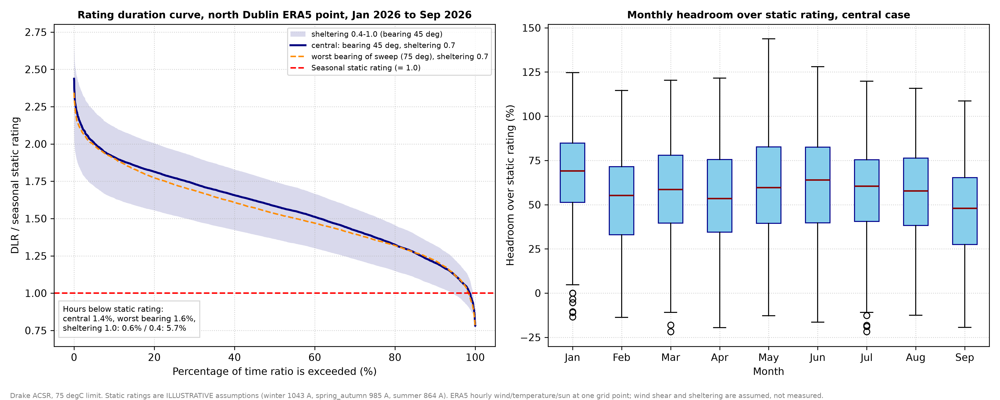
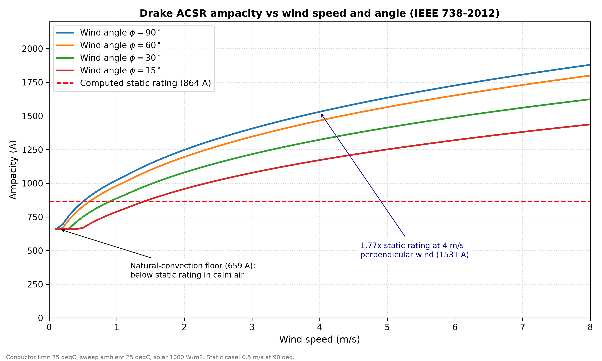
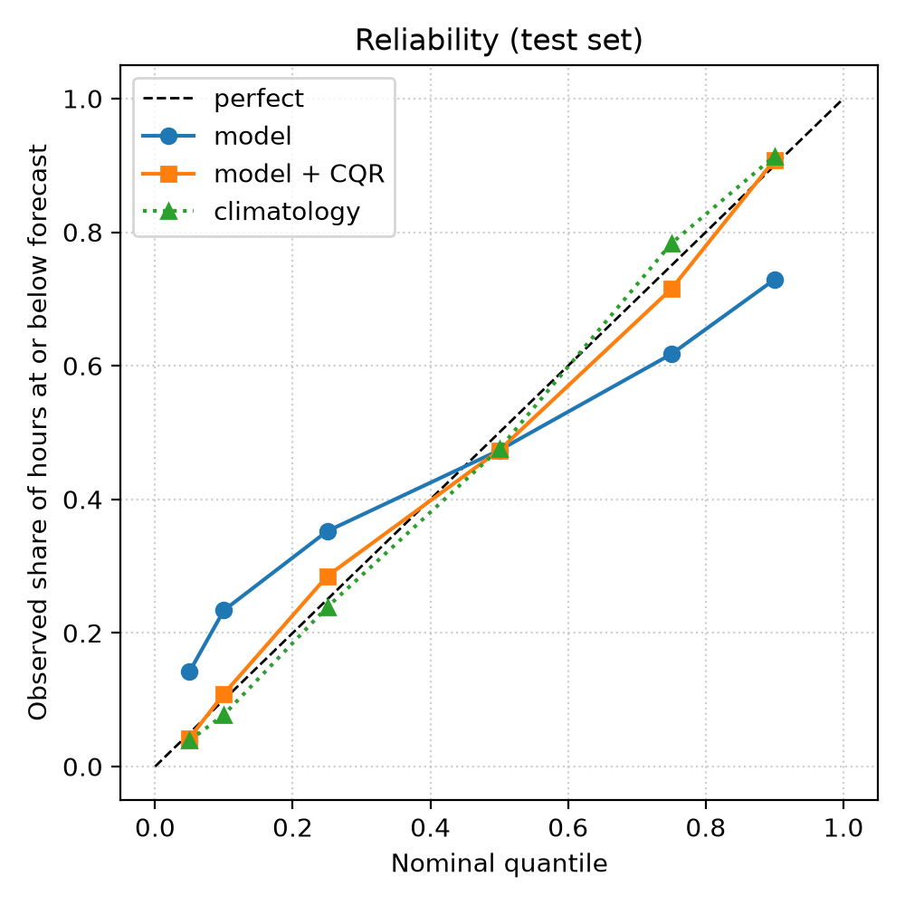

# Probabilistic Dynamic Line Rating for Irish Wind Corridors

How much extra current can an overhead line carry when its rating follows the weather instead of a fixed
seasonal number, how often does it carry *less*, and how confident can we be about tomorrow's rating?

This repository is the **software half** of a two-part project. It turns hourly ERA5 weather into a
conductor rating with an IEEE 738 heat-balance model, quantifies headroom over a static rating with its
uncertainty, and builds a day-ahead quantile forecast of the rating with calibrated risk levels.
A heated-conductor test rig (the hardware half) is planned and **not built yet**.

> **Status: provisional.** Results below use one ERA5 grid point and nine months of data (Jan-Sep 2026),
> an illustrative conductor and illustrative static ratings. They show the method working, not a finding
> about any real ESB Networks or EirGrid line. See [Limitations](#limitations).

## Results (Jan-Sep 2026, north Dublin ERA5 point, 6,552 hours)

Headroom is the dynamic rating relative to the seasonal static rating of the same hour
(illustrative static ratings: winter 1043 A, spring/autumn 985 A, summer 864 A, Drake ACSR 26/7 at 75 degC).

**Central case** (line bearing 45 deg, sheltering factor 0.7, CIGRE TB 601 diffuse model). This is an
assumption, not a result:

| Season | Median headroom | P5 | P1 | Hours below static |
|---|---|---|---|---|
| Winter | +61.7 % | +14.3 % | -4.7 % | 1.5 % |
| Spring/autumn | +53.8 % | +9.9 % | -3.5 % | 1.6 % |
| Summer | +60.5 % | +13.1 % | -1.1 % | 1.2 % |
| All hours | +58.4 % | +11.8 % | -3.1 % | 1.4 % (89 h in 61 events, longest 6 h) |

P5 / P1 are the headroom exceeded in 95 % / 99 % of hours, the numbers an operator can rely on.

**Range over the unknown assumptions** (worst line bearing, sheltering factor 0.4-1.0, two diffuse-sky models):

| Metric | Lowest | Highest |
|---|---|---|
| Median headroom | +31.8 % | +74.8 % |
| P5 headroom | -1.7 % | +22.2 % |
| P1 headroom | -14.1 % | +5.2 % |
| Hours below static rating | 41 (0.6 %) | 387 (5.9 %) |

What drives the range:
- **Sheltering factor dominates.** It moves P5 headroom by about 24 points. The diffuse-sky model moves it by about 0.2.
- **Line bearing matters for the tail.** Lines running roughly east-west (75-90 deg) are the worst case, with about 108 derated hours versus 73-78 for lines at 120-150 deg. They run parallel to the prevailing south-westerlies and westerlies, which then cool them least.
- **Derating is not a winter problem.** Hours below static are spread across all months, including summer calm, warm spells.





### Day-ahead forecast
LightGBM quantile models forecast the rating (in amps) 12-35 hours ahead, issued at 12:00 UTC the day before.
An uncalibrated quantile model is overconfident: its nominal 5 % quantile is breached about 14 % of the time.
A conformal shift on a held-out calibration set brings it back close to nominal at every quantile.
Climatology (same hour and season) is just as well calibrated, and **no forecast skill over climatology is
demonstrated**. The inputs are ERA5 *observations*, not weather forecasts, so skill would not be expected.
Reaching real skill needs archived numerical weather forecasts as inputs.



## Method

- **Heat balance.** IEEE Std 738-2012 steady state: forced and natural convection (the larger applies), radiation, solar gain. Pure scalar Python in `dlr/ieee738.py` so the same file can run on a microcontroller.
- **Weather.** Hourly ERA5 via the Open-Meteo archive API at one grid point (53.45 N, 6.22 W), UTC. 10 m wind is scaled to conductor height (25 m) by a power law and a sheltering factor, because a grid box smooths terrain and obstacles.
- **Solar gain.** Sun position from the NOAA series, evaluated mid-hour because the radiation is a preceding-hour mean. Direct beam is resolved against the line bearing; diffuse and ground-reflected terms use CIGRE TB 601 or the isotropic TB 207 form (`dlr/solar.py`). Horizontal irradiance applied directly to the conductor, the usual shortcut, understates winter heating when the sun is low.
- **Bands, not single numbers.** Line bearing, sheltering factor and diffuse model are assumptions. `dlr/bands.py` runs every combination and reports the worst span and the range.
- **Forecast.** Target is ampacity in amps (a headroom percentage jumps at season boundaries even when the weather does not). Features use only information available at issue time, checked by a test that scrambles the future. Quantile models are calibrated by split conformal prediction and scored with pinball loss against a climatology baseline. Day-block bootstrap gives intervals that respect hourly dependence.
- **Wind-output coincidence.** `scripts/analyze_wind_correlation.py` compares headroom with national wind output from EirGrid system data, including timestamp alignment checks. Results are not reported here yet.

## Validation

180 automated tests (`python -m pytest`), including:
- the heat balance closes to 1e-9 relative at the returned current across a grid of weather, and ampacity responds correctly to wind, temperature, sun, angle and resistance;
- sun position agrees with `pvlib` to within 0.55 deg (elevation) and 0.47 deg (azimuth) over a full year of half-hourly points;
- the diffuse-sky factor of pi/2 is checked by numerical integration;
- forecast features do not change when the future is rewritten (leakage test); conformal coverage reaches its nominal level in simulation;
- daylight-saving handling of the EirGrid timestamps, including the repeated autumn hour.

**Not yet independently validated:** the absolute ampacity values. A few tests pin the code's own output (for example 864 A for the static case) to catch accidental changes. They are not a check against the standard. Comparison with a worked example from IEEE 738-2012 or with the open-source `linerate` package is the next validation step.

## Limitations

1. One ERA5 grid point stands in for a whole corridor, and only nine months are covered. Tail statistics (P1) rest on a few dozen events.
2. Static ratings, conductor properties (emissivity and absorptivity 0.5) and conductor height are illustrative assumptions, not operator data. Headroom is relative to those baselines.
3. Sheltering factor, wind shear and line bearing are assumed, not measured. Comparing ERA5 with Met Eireann observations at Dublin Airport would constrain the first, but not line-specific sheltering.
4. ERA5 is hourly and smooth. Gusts, lulls and the conductor's thermal inertia are not modelled, so brief excursions above the temperature limit are not captured.
5. The forecast uses observed weather as input and is not a true forecast (see above).
6. Wind output is national, not at specific wind farms.
7. The hardware rig is not built.

## Reproduce (Windows PowerShell)

```powershell
pip install -e ".[dev]"
python scripts\ingest_weather.py            # downloads ERA5 for the dates set in dlr\config.py
python scripts\ingest_eirgrid.py            # needs an EirGrid workbook in data\eirgrid\
python scripts\compute_headroom.py          # headroom tables and bands
python scripts\data_coverage.py             # data checks, derating events
python scripts\plot_headroom.py             # duration curve and monthly figure
python scripts\plot_sensitivity.py          # ampacity sensitivity figure
python scripts\train_quantile_forecast.py   # day-ahead forecast and reliability plot
python scripts\analyze_wind_correlation.py  # headroom versus wind output
python -m pytest
```

## Layout

```
dlr/ieee738.py     heat-balance solver (scalar, portable)
dlr/solar.py       sun position and solar gain on a conductor
dlr/pipeline.py    weather table -> ampacity, seasonal static ratings, headroom
dlr/bands.py       bearing x sheltering x diffuse-model scenarios, worst span, range
dlr/forecast.py    day-ahead quantile forecast, conformal calibration, baselines
dlr/eirgrid.py     EirGrid quarter-hourly workbook -> hourly UTC wind
dlr/alignment.py   weather / wind timestamp checks
dlr/config.py      every assumption in one place
scripts/           runnable analyses and plots
test/              pytest suite
```

## Data

- Weather: ERA5 reanalysis (Copernicus / ECMWF) through the [Open-Meteo](https://open-meteo.com) archive API.
- Wind generation: EirGrid system data (quarter-hourly), downloaded by hand into `data/eirgrid/`.

## Development notes

Developed with AI assistance (Claude). The numbers above are produced by the scripts in this repository, and the checks described under Validation are the automated tests.
